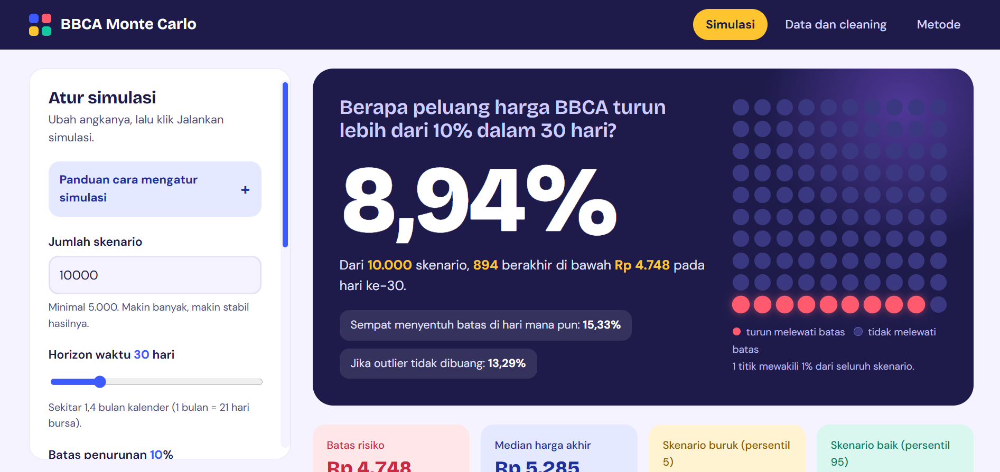
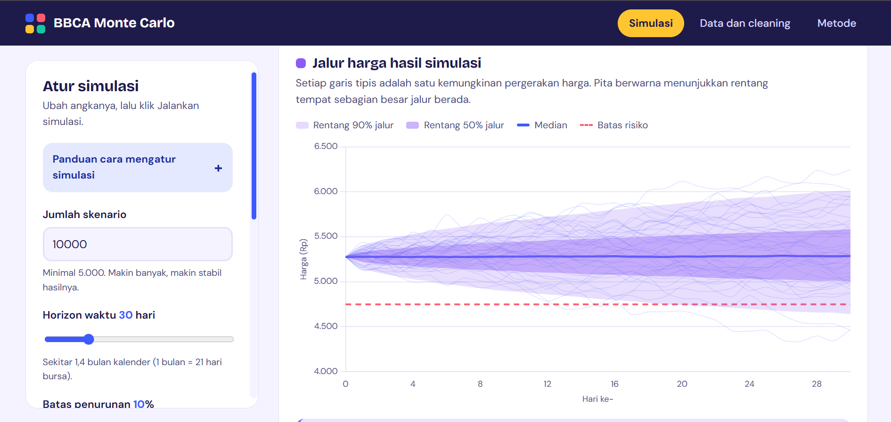
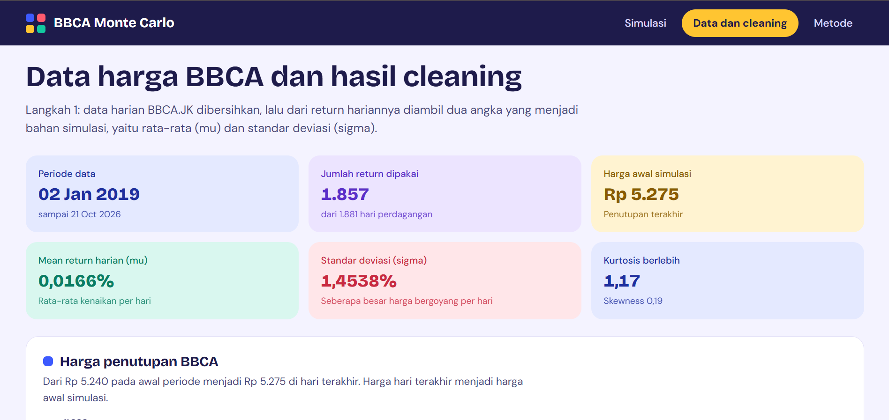
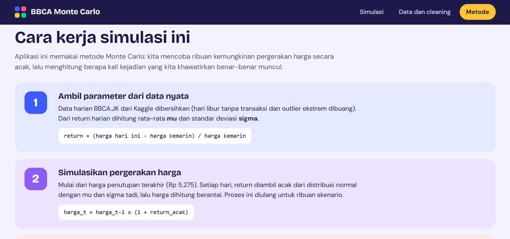

# BBCA Monte Carlo - Simulasi Risiko Saham BCA


Aplikasi web berbasis Flask untuk menghitung **probabilitas harga saham BBCA (Bank Central Asia) turun lebih dari 10% dalam 30 hari ke depan** dengan **simulasi Monte Carlo**. Parameter simulasi diambil dari return harian data historis BBCA.JK, lalu 10.000 skenario pergerakan harga dibangkitkan secara acak.

Tugas Akhir 03 Pemodelan dan Simulasi - Aulia Nazwa Huriah (301240010)

**Demo:** https://301240010AuliaNazwaH.pythonanywhere.com

---

## Fitur Aplikasi

- **Simulasi** - atur jumlah skenario, horizon hari, batas penurunan, seed, dan opsi buang outlier
- **Hasil interaktif** - probabilitas utama, jalur harga, dan histogram dengan garis batas risiko
- **Penjelasan otomatis** - kalimat di bawah setiap grafik berubah mengikuti hasil simulasi
- **Data dan Cleaning** - grafik harga, distribusi return, tahapan cleaning, dan daftar outlier
- **Metode** - penjelasan langkah simulasi dan keterbatasan model

---

## Teknologi

| Komponen | Teknologi |
|---|---|
| Backend | Flask 3.0+ |
| Data Processing | Pandas, NumPy |
| Visualisasi | Chart.js (frontend), Matplotlib/SciPy (notebook) |
| Frontend | HTML, CSS, JavaScript |
| Deployment | PythonAnywhere |

---

## Dataset

- **Sumber:** Kaggle, data harga saham harian BBCA.JK https://www.kaggle.com/datasets/caesarmario/bank-central-asia-stock-historical-price 
- **Periode:** 2 Januari 2019 sampai 21 Oktober 2026
- **Data awal:** 1.896 baris, menjadi 1.857 return setelah cleaning
- **Variabel acak:** return harian dari harga penutupan (Close)
- **Cleaning:** hapus hari tanpa transaksi (15 baris) dan outlier ekstrem metode IQR x 3 (23 baris)

---

## Hasil Simulasi

Pengaturan bawaan: seed `301240010`, 10.000 skenario, 30 hari, batas penurunan 10%.

| Metrik | Nilai |
|---|---|
| Mean / Std Dev return harian | 0,0166% / 1,4538% |
| Harga awal | Rp 5.275 (21 Okt 2026) |
| Batas risiko | Rp 4.748 |
| **Probabilitas turun > 10% di hari ke-30** | **8,94%** |
| Sempat turun > 10% kapan saja | 15,33% |
| Jika outlier tidak dibuang | 13,29% |

---

## Instalasi Lokal

### 1. Clone repository

```bash
git clone https://github.com/Alnazh/ta03-monte-carlo-saham-bbca.git
cd ta03-monte-carlo-saham-bbca
```

### 2. Buat virtual environment

```bash
python -m venv venv

# Windows
venv\Scripts\activate

# Linux / macOS
source venv/bin/activate
```

### 3. Install dependencies

```bash
pip install -r requirements.txt
```

### 4. Jalankan aplikasi

```bash
python app.py
```

Buka browser di `http://127.0.0.1:5000`

---

## Struktur Project

```
ta03-monte-carlo-saham-bbca/
├── app.py                      # Entry point Flask dan simulasi
├── Procfile                    # Konfigurasi Gunicorn
├── requirements.txt            # Daftar dependensi Python
├── .gitignore
│
├── data/
│   └── BBCA_clean.csv          # Data hasil cleaning
│
├── notebook/
│   └── TA03_ModSim_BBCA.ipynb  # Cleaning, simulasi, dan analisis risiko
│
├── templates/                  # HTML template (Jinja2)
│   ├── base.html
│   ├── simulasi.html
│   ├── data.html
│   └── metode.html
│
├── static/
│   ├── css/style.css
│   ├── js/                     # Chart.js, common.js, simulasi.js, data.js
│   └── fonts/
│
└── docs/screenshots/           # Gambar tampilan aplikasi
```

---

## Tampilan Aplikasi






---

## Cara Penggunaan

1. Buka halaman **Simulasi**
2. Atur jumlah skenario, horizon hari, batas penurunan, seed, dan opsi outlier
3. Klik **Jalankan simulasi**
4. Baca probabilitas, grafik, dan penjelasannya
5. Buka **Data dan cleaning** untuk melihat asal parameter simulasi

---
